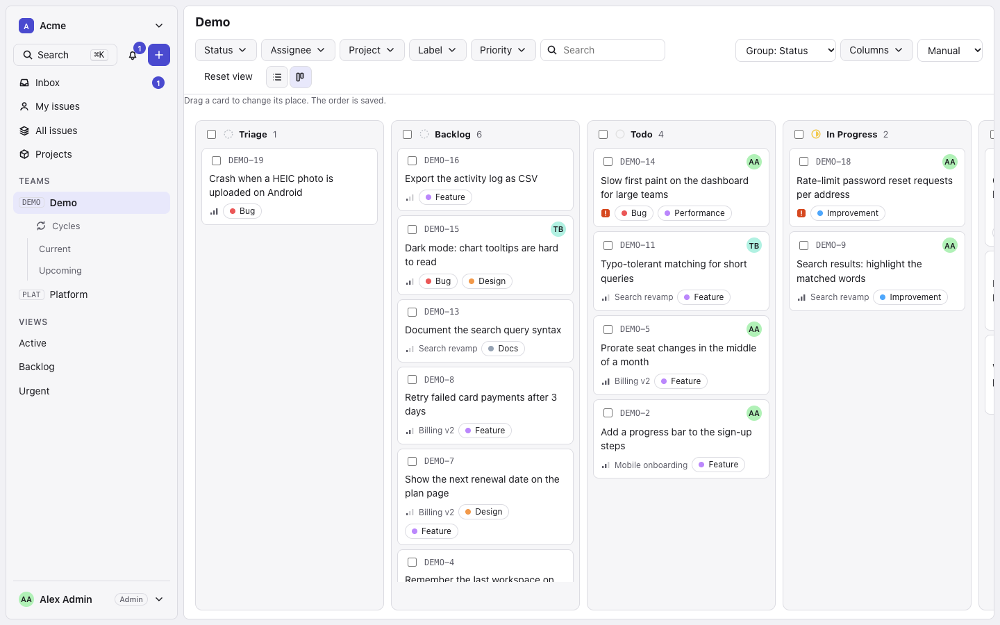
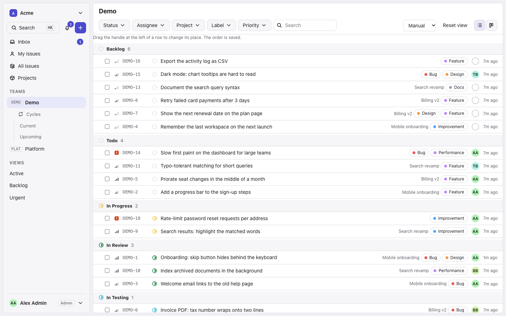
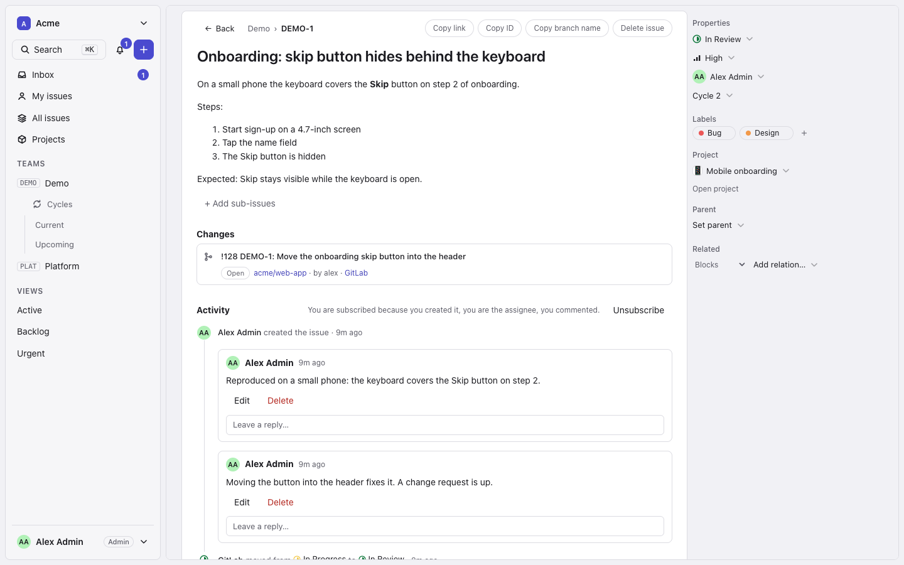
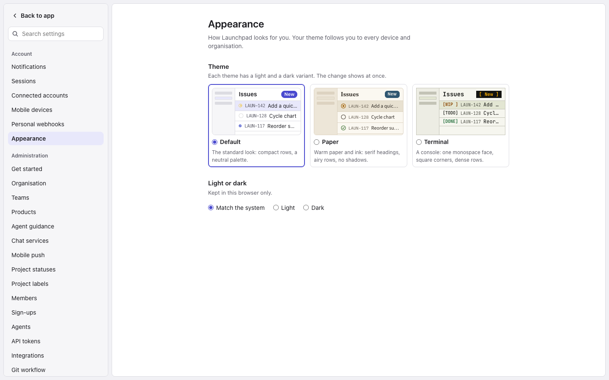
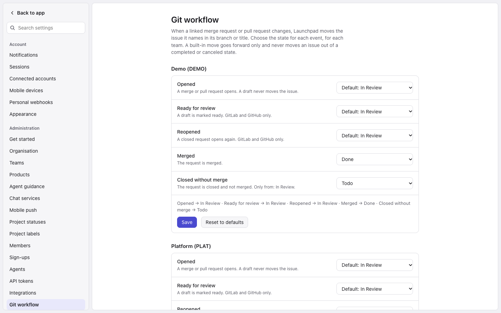
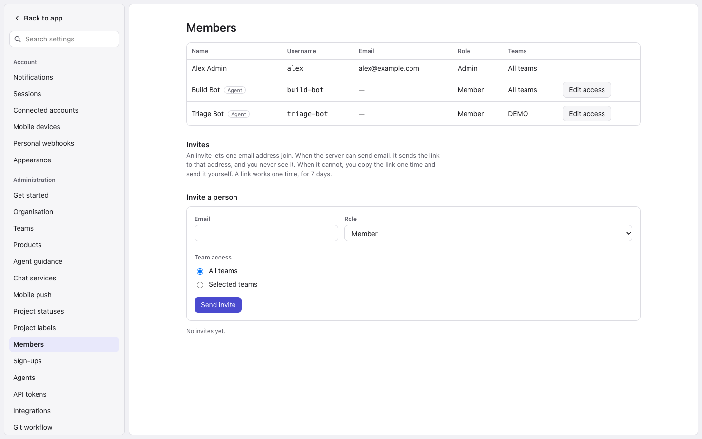

# Launchpad

Launchpad is a self-hosted issue tracker. It has a Go API, a Postgres
database, a web app and an MCP server for AI agents. It can import a Linear
workspace and connect to GitHub, GitLab and Bitbucket.

> **Status: early. Not ready for production use by other people.**
> Launchpad was built for one team's own use. It is open now so that you can
> read it and try it. Expect rough edges, missing features, and changes that
> break things without notice. The API, the database schema and the
> configuration can change. There is no upgrade guarantee and no support.
> Read [`SECURITY.md`](SECURITY.md) before you put real data in it.

## Screenshots

Made-up demo data, Default theme, light mode.

| | |
|---|---|
|  |  |
| **Board**: drag cards between states; Command+Z undoes a move. | **List**: the same issues grouped by state, in manual order. |
|  |  |
| **Issue**: properties, a linked merge request and the activity. | **Appearance**: three themes, each light and dark. |
|  |  |
| **Git workflow**: choose where a merge or pull request moves an issue, for each team. | **Members**: give a member or an agent all teams or selected teams. |

## Features

- **Issues** with teams, workflow states (Triage first), labels, priorities,
  comments, mentions and relations (blocks, related, duplicate). Manual
  order, a remembered view for each page and an activity log for each issue.
  On the board and the list, Command+Z (Ctrl+Z) undoes your last change (a
  move, a create or a field change) and Command+Shift+Z redoes it.
- **Products**: named groups of teams, a tier above teams.
- **Projects, milestones, documents and cycles.** The server creates cycles
  on a schedule and rolls open issues over.
- **Notifications**: email and an in-app inbox for issue changes, with
  one-click unsubscribe.
- **Attachments** in an S3-compatible store (silo), through presigned URLs.
- **Git connections** (Settings, Integrations): GitHub, GitLab and
  Bitbucket. By default an opened merge request moves an issue to the
  team's review state, and a merged one moves it to the testing state. Each
  team can change these moves (Settings, Git workflow). Checks show on the
  issue.
- **Linear import**: in the web app (Settings, Import from Linear) or with
  the command line importer. It keeps original numbers and timestamps.
- **MCP server** (`launchpad-mcp`): 24 tools for agents, and a
  read-only `reviewer` profile.
- **Web app** (React and TypeScript) with an email one-time-code login. No
  passwords. The login API also supports native clients (there are no native
  apps yet).
- **REST API** with a published OpenAPI file (`server/api/openapi.yaml`),
  API tokens with scopes and a change feed (server-sent events).
- **Admin tools**: first-run setup link and checklist, agent users, sign-up
  requests and invites, platform mail settings (Postmark or SMTP), and a
  page for your own sessions.
- **Backups**: a nightly database dump, and optional encrypted off-site
  copies to S3, SFTP, WebDAV or Dropbox.

One install is one organisation.

## What you need

- Docker with Compose v2.20 or newer, `git`, `curl` and `python3`.
- To deploy on a server: Linux, two DNS names and a reverse proxy that ends
  TLS. For example `launchpad.example.com` and `launchpad-files.example.com`.
- To use the web app in a local trial: Node 22 or newer.
- To build the MCP binary from source: Docker (or Go on your host). Releases need no build.

## 1. Run it locally (dev stack)

Use this to try Launchpad on one computer. It uses plain HTTP on
`127.0.0.1` and has public default passwords. It runs Postgres, the API and
`silo` (the bundled S3-compatible file store). Do not expose it.

```bash
git clone https://github.com/Launchingpad/launchpad.git
cd launchpad/server
AUTH_FIXED_OTP=000000 docker compose -p launchpad-dev up -d --build
```

The `-p` name is required. `AUTH_FIXED_OTP=000000` makes every login code
`000000`, so you need no email. If port 8090 is in use, read
[`docs/development.md`](docs/development.md) for the other ports.

Wait for the API, then do the first-run setup with your own values:

```bash
for i in $(seq 1 60); do curl -fsS http://localhost:8090/healthz && break; sleep 2; done
PROJECT=launchpad-dev SETUP_USERNAME=admin SETUP_NAME=Admin \
SETUP_EMAIL=you@example.com ORG_SLUG=acme ORG_NAME=Acme \
TEAM_KEY=ACME TEAM_NAME=Acme scripts/dev-setup.sh
```

The script prints the first admin token once. Save it. Start the web app:

```bash
cd ../web
npm ci
VITE_PROXY_TARGET=http://localhost:8090 npm run dev
```

Open http://localhost:5173 and go to section 4. To stop the stack, open a
second terminal (`npm run dev` keeps the first one busy) and run
`cd server && docker compose -p launchpad-dev down` from the repository root. Add `-v` to delete
the data too.

## 2. Deploy it on a server

1. Set up a reverse proxy that ends TLS for both host names. Send the web
   host to port 4001 and the files host to port 4002. Keep the `Host`
   header. [`docs/self-hosting.md`](docs/self-hosting.md) lists every rule.
2. On the server, clone the repository and run the script. Type your own
   host names when it asks. They have no default.

   ```bash
   git clone https://github.com/Launchingpad/launchpad.git
   cd launchpad
   deploy/deploy.sh
   ```

   To skip the questions, set `WEB_HOST`, `FILES_HOST` and the other values
   in the environment and add `--non-interactive`. Run
   `deploy/deploy.sh --help` for every option.
3. Wait. The first run builds images and takes several minutes. It writes
   `deploy/.env` with generated secrets. Back this file up. Never commit it.
4. On a terminal, the script ends with a setup link. Open it in your
   browser. It works once, for 24 hours. Enter your name, email, the
   organisation and the first team. The page shows the first admin token
   once. Save it in a password manager.
5. To get a new link later, run `deploy/deploy.sh --setup-link` on a
   terminal.
6. Turn on email login. The setup page signs you in once, so you can reach
   Settings. Go to **Settings**, then **Platform**. Choose Postmark or SMTP
   and send a test email. Until mail works, nobody can log in with a code.

Details, backups and rollback: [`docs/deploy.md`](docs/deploy.md).

## 3. Update it

On the server, in your checkout:

```bash
deploy/deploy.sh --update
```

The script takes a backup, runs `git pull --ff-only`, rebuilds and restarts
what changed, and runs a smoke test. It refuses to run on a checkout with
uncommitted changes. The server applies new database migrations when it
starts. There is no automatic rollback: read "Rollback" in
[`docs/deploy.md`](docs/deploy.md#rollback).

To update the dev stack, run `git pull` in the repository root, then
`docker compose -p launchpad-dev up -d --build` in `server/` (keep
`AUTH_FIXED_OTP=000000` set).

Then update the MCP binary on each machine that runs an agent: run the same
install command again (section 5).

## 4. Log in and make a first issue

1. Open your web address (`https://launchpad.example.com`, or
   http://localhost:5173 for the dev stack).
2. Enter your email. Enter the code you get by email. On the dev stack, use
   the `SETUP_EMAIL` you gave in section 1 and the code `000000`.
3. Press **Create issue** (or the key `c`). Pick the team, type a title and
   save. The issue
   gets an identifier such as `ACME-1`.

You can make the same issue with the API and your admin token. Type the
token at a hidden prompt, so it stays out of your shell history:

```bash
read -r -s TOKEN
printf 'Authorization: Bearer %s\n' "$TOKEN" | curl -sS -H @- \
  -H 'Content-Type: application/json' \
  -d '{"team":"ACME","title":"My first issue"}' \
  https://launchpad.example.com/api/v1/orgs/acme/issues
unset TOKEN
```

For the dev stack, use `http://localhost:8090` as the address.

## 5. Connect an agent (MCP)

An agent works through the MCP server. It runs on the agent's machine and
calls your server with a token. For Claude Code there is a plugin that
installs everything.

1. **Create an agent and a token.** In the web app, go to **Settings**,
   then **Agents**. Press **Create agent** (for example `claude`). Then
   press **Create a token for this agent**. Later, the button reads
   **Create a token for** and the agent's name. The token shows once. Save it in a password
   manager. On the server you can use
   `deploy/deploy.sh --mint-token --org acme --user claude --name mcp --scopes read,write --expires-days 90`.
2. **Add the marketplace and install the plugin.**

   ```bash
   claude plugin marketplace add Launchingpad/launchpad
   claude plugin install launchpad@launchpad-mcp
   ```

3. **Set the values.** `claude plugin install` does not ask for them. It
   prints "userConfig options not yet set", and the server does not appear
   until the required values are set. Open Claude Code and run
   `/plugin configure launchpad@launchpad-mcp`. Give your Launchpad URL (for
   example `https://launchpad.example.com`), the organisation slug (for
   example `acme`) and the agent token. The token is stored in your system's
   secure credential store, not in a file you commit. A default team key and
   your files URL (`https://launchpad-files.example.com`, needed for
   `download_attachment`) are optional. You can also pass
   `--config KEY=VALUE` (repeatable: `url`, `org`, `team`, `files_url`) to
   `claude plugin install`; type the token at the `/plugin configure` form so
   it stays out of your shell history.
4. **Start a new session.** A background hook downloads the
   `launchpad-mcp` binary of the same version from the GitHub Release,
   checks its sha256 and keeps it in the plugin's data folder (the MCP server
   does the same if the hook has not finished). Ask the agent to call
   `get_issue` for `ACME-1`. If the first start says the server timed out,
   see "Troubleshooting" in [`docs/mcp.md`](docs/mcp.md).

The plugin also gives the agent a short skill, `launchpad-tickets`, on how to
use tickets and attachments. A new plugin version fetches the matching binary
by itself. Use a server that runs the same release or a newer one.

**Other MCP clients, or no plugin.** The binary is called `launchpad-mcp`
and its variables start with `LAUNCHPAD_`. Download the
install script from the latest release, read it, then run it. It installs to
`~/.local/bin`; run it again to update.

```bash
curl -fsSLO https://github.com/Launchingpad/launchpad/releases/latest/download/install-mcp.sh && less install-mcp.sh && sh install-mcp.sh
```

Then put the token in your environment (never paste it in chat, never commit
it) and add the server to `.mcp.json` (use the full path to the binary):

```json
{
  "mcpServers": {
    "launchpad": {
      "command": "/home/you/.local/bin/launchpad-mcp",
      "args": [],
      "env": {
        "LAUNCHPAD_URL": "https://launchpad.example.com",
        "LAUNCHPAD_TOKEN": "${LAUNCHPAD_TOKEN}",
        "LAUNCHPAD_ORG": "acme",
        "LAUNCHPAD_TEAM": "ACME",
        "LAUNCHPAD_FILES_URL": "https://launchpad-files.example.com"
      }
    }
  }
}
```

For the dev stack, the URL is `http://localhost:8090`. For a reviewer agent
that can only read, add `"args": ["--profile", "reviewer"]` and give it a
`read` token. More options, building from source and the tool list:
[`docs/mcp.md`](docs/mcp.md).

## Configuration: change the default values

Both stacks read their settings from the environment. Every variable is in
[`docs/configuration.md`](docs/configuration.md).

### Production: `deploy/.env`

`deploy/deploy.sh` writes `deploy/.env` on the first run (mode 0600,
ignored by git). It holds your settings and the secrets it generated. After
that first run, this file is the one place to change a value.

To change a value:

1. Edit `deploy/.env` on the server. Keep the form `KEY='value'`. A value
   cannot hold a single quote or a line break. Host names are lower-case and
   hold a dot. Keep the file mode 0600.
2. Run `deploy/deploy.sh` again. It keeps every value in the file, checks
   them, rebuilds what changed and restarts it. It adds a key that a newer
   version needs, and it names the key. It never changes a value you set.
   If a value is wrong, it names the key and stops.

A variable exported in your shell does not reach the stack. Edit the file.

Settings you choose (the first run takes them from the questions, or from
the environment with `--non-interactive`):

| Key | Default | Meaning |
|---|---|---|
| `WEB_HOST`, `FILES_HOST` | none: you must set both | Host names of the web app and of the file store. They must differ. `PUBLIC_BASE_URL` is `https://` plus `WEB_HOST`; it has no separate setting. |
| `DEPLOY_BIND_ADDR` | `127.0.0.1` | Address the two ports bind to. |
| `DEPLOY_WEB_PORT`, `DEPLOY_FILES_PORT` | `4001`, `4002` | Host ports. |
| `BACKUP_AT_UTC`, `BACKUP_KEEP_DAYS` | `03:15`, `30` | Time of the nightly dump and days to keep it. |
| `POSTMARK_SERVER_TOKEN`, `POSTMARK_FROM` | empty | Postmark mail. Optional: you can set Postmark or SMTP in the web app (Settings, Platform). Without a working mail transport, login is off. If the file lacks these keys, a plain re-run takes them from your shell. |
| `TRUSTED_PROXY_CIDRS`, `GIT_ALLOW_PRIVATE_PROVIDERS`, `GIT_ALLOW_PRIVATE_CIDRS`, `BACKUP_ALLOW_PRIVATE_CIDRS` | empty | Optional. Add them by hand. See [`docs/deploy.md`](docs/deploy.md). |

If you change a host, port or bind address, change your reverse proxy to
match.

Set these on the first run only:

- `DEPLOY_PROJECT` (default `launchpad`; never `dev-ops`): a new project
  name makes new, empty volumes and leaves the old data behind.
- `S3_BUCKET` (default `devops-attachments`): a new bucket name hides the
  old attachments.

Do not change these:

- `POSTGRES_PASSWORD`, `SILO_ROOT_USER`, `SILO_ROOT_PASSWORD`: the volumes
  were made with them. `deploy.sh` never makes them again.
- `SETTINGS_ENCRYPTION_KEY` and `BACKUP_ENCRYPTION_KEY`: they seal the mail
  secrets, the git tokens and webhook secrets, and the backup destination
  secrets. There is no key rotation. A changed or lost key makes those
  values unreadable and you must enter them again. If a key is missing or
  wrong, restore it from your copy of `deploy/.env`. Do not make a new one.
- The other generated values (`AUTH_OTP_PEPPER`, `S3_ACCESS_KEY`,
  `S3_SECRET_KEY`, `OFFSITE_*`): leave them as they are.

Keep a copy of `deploy/.env` off the server, in a password manager or an
encrypted backup. Never commit, paste or print it. Do not delete it while
the stack's volumes exist. Never run `--nuke` on an install that holds real
data.

### Dev stack: `server/docker-compose.yml`

The dev stack has public, fixed values: the database password `devops`, the
S3 keys, the login-code pepper and both encryption keys. It logs login
codes. It is for one computer only. Never use these values, or this stack,
in production.

- Set the project name with `-p <name>`, or put `DEV_OPS_PROJECT=<name>` in
  `server/.env` (ignored by git). There is no default.
- Change the host ports with `DEV_OPS_APP_PORT` (8090), `DEV_OPS_PG_PORT`
  (5433) and `DEV_OPS_S3_PORT` (9100). They bind to `127.0.0.1` only. If you
  change the app port, also set `PUBLIC_BASE_URL` to match.
- Put other overrides in `server/.env` too, or on the `up` command. Only
  variables that `server/docker-compose.yml` writes as `${VAR}` take effect.
  Run `docker compose -p <name> up -d` again after a change. Compose
  recreates the container.
- `AUTH_FIXED_OTP=000000` makes every login code `000000`. It must be
  exactly 6 digits, `LOG_ENV` must be `local` or `test` (the dev stack's
  default), and no Postmark token may be set. The production compose file
  does not pass it, and the app refuses it outside `local` and `test`. Use
  it on a throwaway stack only.

## Where to read more

There is no wiki. The `docs/` folder is the manual.

- [`docs/README.md`](docs/README.md): the index.
- [`docs/quickstart.md`](docs/quickstart.md): install in two steps.
- [`docs/development.md`](docs/development.md): the dev stack in detail.
- [`docs/self-hosting.md`](docs/self-hosting.md): the short server guide.
- [`docs/deploy.md`](docs/deploy.md): the full production runbook.
- [`docs/configuration.md`](docs/configuration.md): every environment
  variable.
- [`docs/mcp.md`](docs/mcp.md): the MCP server and its tools.
- [`docs/architecture.md`](docs/architecture.md): how it is built.
- [`server/api/openapi.yaml`](server/api/openapi.yaml): the REST API.

The repository has these folders:

- `server/`: the Go API, the MCP server, the importer and migrations.
- `web/`: the web app.
- `deploy/`: the production stack and its scripts.
- `docs/`: documentation. `docs/internal/` holds old design notes, kept for
  history.

## Contributing

Read [`CONTRIBUTING.md`](CONTRIBUTING.md) first. It shows how to run the
tests. Follow the [`CODE_OF_CONDUCT.md`](CODE_OF_CONDUCT.md). To report a
security problem, read [`SECURITY.md`](SECURITY.md). [`AGENTS.md`](AGENTS.md)
holds the working rules for AI coding agents that work on this repository.
Open a pull request into `master`; it is squash-merged.

## License

Apache License 2.0. See [`LICENSE`](LICENSE).
